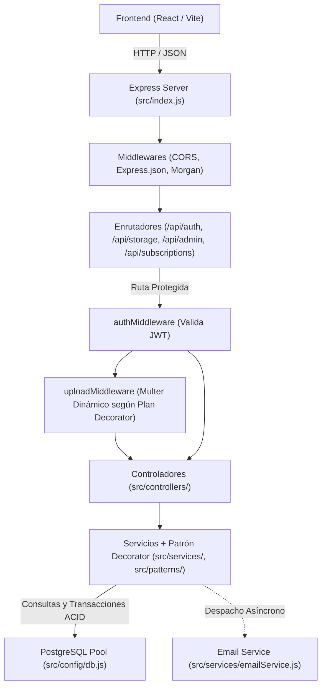

# Arquitectura y Guía Técnica del Backend - VinCloud

> **Documento de Referencia Técnica para Desarrolladores y Agentes LLM**  
> Proyecto: Plataforma como Servicio (PaaS) - Almacenamiento en la Nube (*VinCloud*)  
> Contexto: Proyecto Final de Ingeniería de Software I - 6to Semestre, Universidad Rafael Landívar.

---

## 1. Visión General del Proyecto

VinCloud es una plataforma PaaS (Platform as a Service) orientada a Almacenamiento como Servicio (*Storage as a Service*). Permite a los usuarios registrarse, autenticarse, gestionar cuotas de almacenamiento, administrar planes/suscripciones mediante el **Patrón Decorator** y administrar recursos digitales en la nube.

> [!IMPORTANT]
> **REGLA CRÍTICA DEL PROYECTO (Verificada en Contexto_LLM.md):**  
> **NUNCA modificar la apariencia visual ni la estructura del Frontend (`Front_/`)**. Todas las integraciones y adaptaciones deben respetar el diseño y contratos existentes de la interfaz de usuario.

---

## 2. Stack Tecnológico del Backend

| Componente | Tecnología | Propósito |
| :--- | :--- | :--- |
| **Entorno de Ejecución** | Node.js (ES Modules, `"type": "module"`) | Plataforma de ejecución del servidor |
| **Framework Web** | Express v5.x | Enrutamiento RESTful, middlewares y control de peticiones |
| **Base de Datos** | PostgreSQL 16+ | Almacenamiento relacional de usuarios, roles, cuotas, planes, suscripciones, pagos y metadatos |
| **Cliente de BD** | `pg` (node-postgres) | Conexión mediante pool optimizado, consultas parametrizadas y transacciones ACID (`withTransaction`) |
| **Autenticación** | `jsonwebtoken` (JWT) | Generación y verificación de tokens stateless |
| **Seguridad de Claves** | `bcryptjs` | Algoritmo de hash unidireccional y salteo (10 rounds) |
| **Correos Electrónicos** | `nodemailer` | Servicio de notificación SMTP (Mailtrap / Gmail) |
| **Procesamiento de Archivos**| `multer` | Manejo dinámico de cargas binarias multiparte (`multipart/form-data`) según la suscripción del usuario |
| **Utilidades** | `cors`, `dotenv`, `morgan` | Control de orígenes cruzados, variables de entorno y logging HTTP |

---

## 3. Estructura de Directorios

```text
Servicio-de-Almacenamiento/
├── Contexto_LLM.md               # Directrices maestras del proyecto
├── ARQUITECTURA_BACKEND.md       # Este documento técnico
├── DiagramaDecorator.jpeg        # Diagrama de clases del Patrón Decorator para Planes/Suscripciones
├── README.md                     # Información general del repositorio
├── docs/                         # Documentación de diseño, UML y manuales
│   ├── 01-requisitos/
│   ├── 02-diseno/                # Diagramas de arquitectura, ER y UML
│   ├── 03-manuales/              # Guías técnicas (GUIA_MULTER_Y_TECNOLOGIAS.md, GUIA_USO_API.md)
│   └── 04-mockups/               # Prototipos y capturas de Figma
├── database/                     # Definición y scripts SQL de la base de datos
│   ├── inicializacion/
│   │   └── schema.sql            # Definición DDL (tablas rol, usuario, carpeta, archivo, plan, suscripcion, pago y vistas)
│   └── datos-iniciales/
│       └── seed.sql              # Inserción de datos iniciales (roles y catálogo de planes)
└── Back_/                        # Código fuente del Backend
    ├── .env.example              # Plantilla de variables de entorno requeridas
    ├── package.json              # Dependencias y scripts de ejecución
    ├── Pruebas_Front/            # Borradores HTML temporales para probar funcionalidades antes de integrarse al frontend
    │   ├── Contexto-o-Orientacion.md      # Directrices de pruebas temporales de interfaz
    │   ├── verificacion-correo.html       # Borrador funcional para validación y reenvío de correo
    │   ├── registro-roles.html            # Borrador para probar registro e inicio de sesión con roles
    │   ├── subida-archivos.html           # Borrador para probar almacenamiento, carpetas, papelera e invitaciones
    │   ├── panel-administrador.html       # Borrador para probar gestión administrativa, planes y reportes
    │   └── suscripciones-decorator.html   # Borrador para probar el módulo de suscripciones, Patrón Decorator y Multer dinámico
    └── src/
        ├── app.js                # Configuración de Express y montaje de rutas (/api/auth, /api/storage, /api/admin, /api/subscriptions)
        ├── index.js              # Arranque del servidor y validación de variables de entorno
        ├── config/
        │   ├── constants.js      # Reglas de negocio (cuotas, roles, propósitos de token, PLAN_UPLOAD_POLICIES)
        │   ├── db.js             # Pool de PostgreSQL, helper query() y transacciones ACID withTransaction()
        │   ├── env.js            # Carga única de variables de entorno
        │   └── mail.js           # Transporter SMTP de Nodemailer
        ├── patterns/
        │   └── planDecorator.js  # Implementación del Patrón Decorator (Plan, PlanGratuito, DecoradorPlanes, PlanBasico, Profesional, Empresarial)
        ├── controllers/
        │   ├── authController.js         # Controlador HTTP de autenticación
        │   ├── storageController.js      # Controlador HTTP de almacenamiento, papelera e invitaciones
        │   ├── adminController.js        # Controlador HTTP del rol Administrador
        │   └── subscriptionController.js # Controlador HTTP de suscripciones, pagos y simulador Decorator
        ├── middlewares/
        │   ├── authMiddleware.js     # Validación de JWT (authenticateToken) y rol Administrador (requireAdmin)
        │   ├── errorHandler.js       # Manejo centralizado de 404 y errores HTTP
        │   └── uploadMiddleware.js   # Carga y almacenamiento en disco con Multer dinámico gobernado por el Patrón Decorator
        ├── repositories/
        │   ├── userRepository.js         # Consultas SQL de usuarios y cuotas de almacenamiento
        │   ├── fileRepository.js         # Consultas SQL para archivos (CRUD, búsquedas, recientes, papelera)
        │   ├── folderRepository.js       # Consultas SQL para carpetas (jerarquías, conteo recursivo)
        │   ├── adminRepository.js        # Consultas SQL de administración (clientes, planes, reportes)
        │   └── subscriptionRepository.js # Consultas y transacciones ACID de planes, suscripciones y pagos
        ├── routes/
        │   ├── authRoutes.js         # Rutas REST de autenticación (/api/auth)
        │   ├── storageRoutes.js      # Rutas REST de almacenamiento (/api/storage)
        │   ├── adminRoutes.js        # Rutas REST de administración (/api/admin)
        │   └── subscriptionRoutes.js # Rutas REST de suscripciones y pagos (/api/subscriptions)
        ├── services/
        │   ├── accountService.js      # Verificación de correo y recuperación de contraseñas
        │   ├── authService.js         # Lógica de registro, login, asignación de roles y perfil
        │   ├── emailService.js        # Generación de templates HTML y despacho de correos
        │   ├── passwordService.js     # Hashing y validación de contraseñas con bcrypt
        │   ├── storageService.js      # Lógica de almacenamiento, cuotas, papelera e invitaciones
        │   ├── adminService.js        # Lógica de administración de usuarios, planes y reportes
        │   ├── subscriptionService.js # Lógica de contratación, cambio, renovación, cancelación y resolución de Decoradores
        │   └── tokenService.js        # Firma y validación de tokens JWT de sesión y propósito
        ├── templates/                # Plantillas HTML de correos (bienvenida, verificación, reset, invitación)
        ├── utils/                    # Utilidades (httpError.js, escapeHtml.js)
        ├── validators/               # Validación de entrada (authValidator, storageValidator, adminValidator, subscriptionValidator)
        └── scripts/
            ├── initDb.js             # Automatización de creación de BD, schema y seed
            └── testEmail.js          # Verificación y pruebas del transporte SMTP
```

---

## 4. Base de Datos y Modelo de Datos

La base de datos relacional se gestiona en PostgreSQL bajo el nombre `almacenamiento_db`.

### 4.1. Tablas y Restricciones ([`schema.sql`](file:///C:/Users/andre/OneDrive/Documentos/GitHub/Servicio-de-Almacenamiento/database/inicializacion/schema.sql))

#### Tabla `rol`
Representa los niveles de privilegios dentro de la plataforma.
- `id` (`INTEGER GENERATED ALWAYS AS IDENTITY`): Llave primaria.
- `nombre` (`VARCHAR(50) NOT NULL UNIQUE`): Nombre del rol (`'Administrador'`, `'Usuario'`).

#### Tabla `usuario`
Representa las cuentas de usuario registradas.
- `id` (`INTEGER GENERATED ALWAYS AS IDENTITY`): Llave primaria.
- `rol_id` (`INTEGER NOT NULL`): Llave foránea hacia `rol(id)`.
- `nombre` (`VARCHAR(100) NOT NULL`): Nombre completo del usuario.
- `correo` (`VARCHAR(150) NOT NULL UNIQUE`): Correo electrónico del usuario.
- `contrasena_hash` (`VARCHAR(255) NOT NULL`): Hash de la contraseña con bcrypt.
- `fecha_registro` (`DATE NOT NULL DEFAULT CURRENT_DATE`): Fecha de alta en el sistema.
- `correo_verificado` (`BOOLEAN NOT NULL DEFAULT FALSE`): Bandera de verificación.
- `nivel_acceso` (`VARCHAR(50) NOT NULL`): Nivel asignado (`'estandar'`).
- `espacio_consumido` (`BIGINT NOT NULL DEFAULT 0 CHECK (espacio_consumido >= 0)`): Bytes consumidos.
- `espacio_disponible` (`BIGINT NOT NULL DEFAULT 0 CHECK (espacio_disponible >= 0)`): Bytes totales asignados (5 GB por defecto = `5,368,709,120` bytes).

#### Tabla `carpeta`
Representa la estructura jerárquica de directorios del usuario.
- `id` (`INTEGER GENERATED ALWAYS AS IDENTITY`): Llave primaria.
- `usuario_id` (`INTEGER NOT NULL`): Llave foránea hacia `usuario(id)` con `ON DELETE CASCADE`.
- `carpeta_padre_id` (`INTEGER`): Llave foránea recursiva hacia `carpeta(id)` con `ON DELETE CASCADE` (`NULL` para la raíz).
- `nombre` (`VARCHAR(255) NOT NULL`): Nombre de la carpeta.
- `fecha_creacion` (`DATE NOT NULL DEFAULT CURRENT_DATE`): Fecha de creación.

#### Tabla `archivo`
Representa los archivos subidos por el usuario a una carpeta o al directorio raíz.
- `id` (`INTEGER GENERATED ALWAYS AS IDENTITY`): Llave primaria.
- `usuario_id` (`INTEGER NOT NULL`): Llave foránea hacia `usuario(id)` con `ON DELETE CASCADE`.
- `carpeta_id` (`INTEGER`): Llave foránea hacia `carpeta(id)` con `ON DELETE CASCADE` (`NULL` si se ubica en la raíz).
- `nombre` (`VARCHAR(255) NOT NULL`): Nombre original del archivo.
- `tamano` (`BIGINT NOT NULL CHECK (tamano >= 0)`): Tamaño en bytes del archivo.
- `tipo` (`VARCHAR(100) NOT NULL`): Tipo de archivo o MIME type.
- `fecha_subida` (`DATE NOT NULL DEFAULT CURRENT_DATE`): Fecha en que se completó la subida.
- `en_papelera` (`BOOLEAN NOT NULL DEFAULT FALSE`): Indica si el archivo fue enviado a la papelera (borrado lógico).
- `fecha_eliminacion` (`DATE`): Fecha en que el archivo fue movido a la papelera (`NULL` si está activo).

#### Tablas y Vistas de Soporte de Planes, Suscripciones y Pagos
- `plan`: Catálogo de planes (`id`, `nombre`, `descripcion`, `precio`, `capacidad_almacenamiento`, `vigencia_dias`, `activo`).
- `suscripcion`: Contratación de planes por usuario (`id`, `usuario_id`, `plan_id`, `fecha_inicio`, `fecha_renovacion`, `estado` en `'pendiente' | 'activa' | 'vencida' | 'cancelada'`, con índice único parcial `uq_suscripcion_activa_por_usuario`).
- `pago`: Registro de transacciones asociadas a la suscripción (`id`, `usuario_id`, `suscripcion_id`, `monto`, `fecha` `TIMESTAMPTZ`, `estado` en `'pendiente' | 'aprobado' | 'rechazado'`, `tipo` en `'contratacion' | 'renovacion'`, `referencia`, `tarjeta_ultimos4`).
- Vistas: `v_historial_pagos` (historial detallado de pagos por usuario) y `v_suscripcion_actual` (suscripción activa con datos del plan y `dias_restantes`).

---

## 5. Arquitectura por Capas del Backend



### 5.1. Servidor Principal ([`src/index.js`](file:///C:/Users/andre/OneDrive/Documentos/GitHub/Servicio-de-Almacenamiento/Back_/src/index.js))
- Configura CORS para permitir solicitudes del cliente web.
- Configura el parseo de cuerpos JSON con límite seguro.
- Registra logs con `morgan('dev')` en entornos que no sean de producción.
- Expone ruta de Health Check: `GET /api/health`.
- Conecta los enrutadores `/api/auth`, `/api/storage`, `/api/admin` y `/api/subscriptions`.
- Implementa control centralizado para respuestas `404 Not Found` y manejo de excepciones no capturadas `500 Internal Server Error`.

### 5.2. Conexión a Base de Datos ([`src/config/db.js`](file:///C:/Users/andre/OneDrive/Documentos/GitHub/Servicio-de-Almacenamiento/Back_/src/config/db.js))
- Utiliza `pg.Pool` con límite de 20 clientes concurrentes e `idleTimeoutMillis` de 30 segundos.
- Provee `query(text, params)` para ejecutar sentencias preparadas y `withTransaction(callback)` para ejecutar transacciones ACID (`BEGIN` / `COMMIT` / `ROLLBACK`).

### 5.3. Módulo de Autenticación ([`src/controllers/authController.js`](file:///C:/Users/andre/OneDrive/Documentos/GitHub/Servicio-de-Almacenamiento/Back_/src/controllers/authController.js))
- **Registro (`register`):** Sanitiza correo/contraseña, resuelve el rol (`Usuario` o `Administrador`), asigna la cuota inicial de 5 GB (`PlanGratuito`), emite JWT de sesión y despacha correos de bienvenida y verificación.
- **Inicio de Sesión (`login`):** Valida formato regex, compara hash con `bcrypt`, verifica privilegios de rol y emite el token JWT.
- **Consulta de Perfil (`getProfile` / `/me`):** Devuelve datos actualizados del usuario desde PostgreSQL.
- **Verificación de Correo (`verifyEmail` / `resendVerification`) y Recuperación de Contraseña (`forgotPassword` / `resetPassword`):** Gestionados en `accountService.js` mediante tokens con propósito (`TOKEN_PURPOSES`).

### 5.4. Middleware de Seguridad ([`src/middlewares/authMiddleware.js`](file:///C:/Users/andre/OneDrive/Documentos/GitHub/Servicio-de-Almacenamiento/Back_/src/middlewares/authMiddleware.js))
- **`authenticateToken`**: Valida `Authorization: Bearer <token>` e inyecta `req.user`.
- **`requireAdmin`**: Comprueba que `req.user.rol === 'Administrador'`.

### 5.5. Servicio de Correo ([`src/services/emailService.js`](file:///C:/Users/andre/OneDrive/Documentos/GitHub/Servicio-de-Almacenamiento/Back_/src/services/emailService.js))
- Opera con SMTP real o en modo simulación transparente cuando no hay credenciales configuradas.

### 5.6. Módulo de Suscripciones y Patrón Decorator ([`src/patterns/planDecorator.js`](file:///C:/Users/andre/OneDrive/Documentos/GitHub/Servicio-de-Almacenamiento/Back_/src/patterns/planDecorator.js) y [`src/services/subscriptionService.js`](file:///C:/Users/andre/OneDrive/Documentos/GitHub/Servicio-de-Almacenamiento/Back_/src/services/subscriptionService.js))
Implementa fielmente el diagrama de clases [`DiagramaDecorator.jpeg`](file:///C:/Users/andre/OneDrive/Documentos/GitHub/Servicio-de-Almacenamiento/DiagramaDecorator.jpeg):
- **`<<interfaz>> Plan`**: Define los métodos `+ costo()`, `+ decripcion()` (y alias `+ descripcion()`) y `+ almacenamiento()`, además de `+ obtenerPoliticaMulter()`.
- **`PlanGratuito` (Componente Concreto Base)**: Implementa `Plan` con `costo() = 0`, `almacenamiento() = 5 GB` (`5,368,709,120` bytes) y política de Multer inicial (máx. 10 MB por archivo, 1 archivo por subida, enlaces de 24h).
- **`DecoradorPlanes` (Decorador Base)**: Implementa `Plan`, mantiene la referencia `+ wrappee: Plan` y delega `costo()`, `decripcion()` y `almacenamiento()` al objeto envuelto.
- **Decoradores Concretos (`PlanBasico`, `Profesional`, `Empresarial`)**:
  - **`PlanBasico`**: Envuelve `wrappee` agregando capacidad hasta **50 GB** (+45 GB sobre `PlanGratuito`), costo **Q25.00** y política dinámica de Multer de **50 MB por archivo** y hasta **3 archivos simultáneos** (enlaces de 7 días).
  - **`Profesional`**: Envuelve `wrappee` agregando capacidad hasta **200 GB** (+195 GB sobre `PlanGratuito`), costo **Q60.00** y política dinámica de Multer de **250 MB por archivo** y hasta **10 archivos simultáneos** (enlaces de 30 días).
  - **`Empresarial`**: Envuelve `wrappee` agregando capacidad hasta **1 TB** (+1,019 GB sobre `PlanGratuito`), costo **Q150.00** y política dinámica de Multer de **1 GB por archivo** y hasta **25 archivos simultáneos** (enlaces de 365 días).
- **Transacciones ACID de Suscripción y Pagos ([`src/repositories/subscriptionRepository.js`](file:///C:/Users/andre/OneDrive/Documentos/GitHub/Servicio-de-Almacenamiento/Back_/src/repositories/subscriptionRepository.js))**:
  - Cumple el flujo de [`modelo-datos-avance2.md`](file:///C:/Users/andre/OneDrive/Documentos/GitHub/Servicio-de-Almacenamiento/docs/02-diseno/database/modelo-datos-avance2.md): crea la suscripción y el pago en `'pendiente'`, procesa la aprobación o rechazo con pasarela simulada (guardando únicamente `tarjeta_ultimos4` y `referencia`), cancela cualquier suscripción activa previa en cambios de plan, activa la nueva suscripción y sincroniza `usuario.espacio_disponible` con `planDecorado.almacenamiento()`. Al cancelar o vencer, desenvuelve al usuario de vuelta a `PlanGratuito` (5 GB).

### 5.7. Middleware Dinámico de Carga con Multer ([`src/middlewares/uploadMiddleware.js`](file:///C:/Users/andre/OneDrive/Documentos/GitHub/Servicio-de-Almacenamiento/Back_/src/middlewares/uploadMiddleware.js))
- En cada petición a `POST /api/storage/upload`, resuelve primero el objeto `Plan` decorado del usuario autenticado (`resolveUserPlanDecorator(req.user.id)`).
- Configura la instancia de Multer al vuelo con los límites del decorador activo (`limits.fileSize` y `limits.files`).
- Si el usuario intenta subir un archivo más pesado o más archivos simultáneos de los que permite su suscripción actual, Multer aborta la carga, limpia cualquier archivo temporal y devuelve un `HttpError(400)` indicando la clase del decorador activo y el límite correspondiente.
- Mantiene el almacenamiento físico desacoplado detrás de `getPhysicalFilePath` en `storageService.js` para facilitar una futura migración desde Multer en disco hacia almacenamiento cloud.

### 5.8. Servicio de Almacenamiento ([`src/services/storageService.js`](file:///C:/Users/andre/OneDrive/Documentos/GitHub/Servicio-de-Almacenamiento/Back_/src/services/storageService.js))
- **`uploadFile`**: Soporta tanto carga individual (`req.file`) como carga múltiple (`req.files`) según el decorador activo, valida la cuota total contra `planDecorado.almacenamiento()` y persiste los archivos atómicamente.
- **`createShareInvitation`**: Asigna dinámicamente la vigencia del enlace compartido (`24h`, `7d`, `30d` o `365d`) según el decorador de suscripción del usuario.

### 5.9. Servicio de Administración ([`src/services/adminService.js`](file:///C:/Users/andre/OneDrive/Documentos/GitHub/Servicio-de-Almacenamiento/Back_/src/services/adminService.js))
- Implementa `getUsers`, `updateUser`, `deleteUser`, `getPlans`, `createPlan`, `updatePlan`, `getUserPlans` y `generateReport`.

---

## 6. Especificación de Endpoints (API REST)

### Base URL: `http://localhost:5000/api`

| Método | Endpoint | Autenticación | Descripción |
| :--- | :--- | :--- | :--- |
| `GET` | `/health` | Pública | Verifica el estado del servidor y timestamp actual |
| `POST` | `/auth/register` | Pública | Registra un nuevo usuario (`tipoCuenta` opcional), emite tokens y despacha correos |
| `POST` | `/auth/login` | Pública | Autentica credenciales con validación regex y emite token JWT |
| `GET` | `/auth/me` | Requerida (Bearer Token) | Devuelve perfil, cuota y estado de verificación (`correoVerificado`) |
| `GET` | `/auth/verify` | Pública (`?token=...`) | Valida el token desde el enlace del correo |
| `POST` | `/auth/verify` | Pública | Valida el token enviado por JSON `{ token }` |
| `POST` | `/auth/verify-email` | Pública | Valida el token de verificación desde el frontend React |
| `POST` | `/auth/resend-verification` | Pública | Reenvía correo con nuevo token si la cuenta no ha sido verificada |
| `POST` | `/auth/forgot-password` | Pública | Envía correo con token para restablecer contraseña |
| `POST` | `/auth/reset-password` | Pública | Restablece la contraseña con token válido y nueva clave |
| `GET` | `/subscriptions/plans` | Pública | Lista el catálogo de planes junto con la evaluación del Patrón Decorator y límites de Multer |
| `POST` | `/subscriptions/decorator-preview` | Pública | Simula el encadenamiento de `DecoradorPlanes` sobre `PlanGratuito` (`wrappee: Plan`) |
| `GET` | `/subscriptions/me` | Requerida (Bearer) | Obtiene la suscripción activa, el objeto `Plan` decorado, la política Multer y el historial |
| `POST` | `/subscriptions/subscribe` | Requerida (Bearer) | Contrata o cambia de plan usando el Patrón Decorator y registra el pago en `pago` |
| `POST` | `/subscriptions/change` | Requerida (Bearer) | Cambia el plan activo del usuario cancelando el anterior en una sola transacción ACID |
| `POST` | `/subscriptions/renew` | Requerida (Bearer) | Renueva la suscripción activa extendiendo `fecha_renovacion` y registrando el pago |
| `POST` | `/subscriptions/cancel` | Requerida (Bearer) | Cancela la suscripción activa y restablece al usuario a `PlanGratuito` (5 GB) |
| `GET` | `/subscriptions/payments` | Requerida (Bearer) | Devuelve el historial de pagos del usuario desde `v_historial_pagos` |
| `GET` | `/storage/shared/:token` | Pública (Invitado) | Obtiene metadatos de un archivo compartido mediante enlace de invitación |
| `GET` | `/storage/shared/:token/download` | Pública (Invitado) | Descarga o visualiza (`?inline=true`) un archivo compartido |
| `POST` | `/storage/upload` | Requerida (Bearer) | Sube uno o varios archivos con Multer dinámico validando límites y cuota del `Plan` decorado |
| `GET` | `/storage/files` | Requerida (Bearer) | Lista carpetas y archivos (opcional `?carpetaId=...`) |
| `GET` | `/storage/files/recent` | Requerida (Bearer) | Obtiene los archivos más recientes (opcional `?limit=...`) |
| `GET` | `/storage/files/search` | Requerida (Bearer) | Busca archivos por coincidencia en el nombre (`?q=...`) |
| `GET` | `/storage/files/:id/view` | Requerida (Bearer) | Visualiza un archivo en modo inline en el navegador |
| `GET` | `/storage/files/:id/download` | Requerida (Bearer) | Descarga el archivo binario en streaming seguro |
| `POST` | `/storage/files/:id/share` | Requerida (Bearer) | Genera enlace de invitación con vigencia dinámica según la suscripción |
| `PATCH` | `/storage/files/:id` | Requerida (Bearer) | Renombra un archivo (`{ nuevoNombre }`) |
| `DELETE` | `/storage/files/:id` | Requerida (Bearer) | Mueve un archivo a la papelera (o elimina con `?permanent=true`) |
| `GET` | `/storage/trash` | Requerida (Bearer) | Lista los archivos en la papelera del usuario |
| `DELETE` | `/storage/trash` | Requerida (Bearer) | Vacía toda la papelera y libera el espacio consumido |
| `POST` | `/storage/trash/:id/restore` | Requerida (Bearer) | Restaura un archivo desde la papelera |
| `DELETE` | `/storage/trash/:id` | Requerida (Bearer) | Elimina permanentemente un archivo de la papelera y libera cuota |
| `POST` | `/storage/folders` | Requerida (Bearer) | Crea una carpeta (`{ nombre, carpetaPadreId }`) |
| `PATCH` | `/storage/folders/:id` | Requerida (Bearer) | Renombra una carpeta (`{ nuevoNombre }`) |
| `DELETE` | `/storage/folders/:id` | Requerida (Bearer) | Elimina una carpeta y sus contenidos liberando cuota |
| `GET` | `/admin/reports` | Admin (Bearer + `requireAdmin`) | Genera el reporte general del servicio (`usuariosActivos`, `espacioTotalConsumido`, `ingresosSimulados`) |
| `GET` | `/admin/users` | Admin (Bearer + `requireAdmin`) | Lista todas las cuentas de clientes, su consumo y suscripción activa |
| `PATCH` | `/admin/users/:id` | Admin (Bearer + `requireAdmin`) | Actualiza rol, cuota (`espacioDisponible`/`cuotaGb`) o verificación de un usuario |
| `DELETE` | `/admin/users/:id` | Admin (Bearer + `requireAdmin`) | Elimina la cuenta de un cliente y limpia sus archivos en disco |
| `GET` | `/admin/user-plans` | Admin (Bearer + `requireAdmin`) | Visualiza la lista de planes y consumo por usuario (Diagrama de Actividad) |
| `GET` | `/admin/plans` | Admin (Bearer + `requireAdmin`) | Lista el catálogo completo de planes (activos e inactivos) |
| `POST` | `/admin/plans` | Admin (Bearer + `requireAdmin`) | Crea un nuevo plan en el catálogo (`nombre`, `precio`, `capacidadGb`, `vigenciaDias`) |
| `PATCH` | `/admin/plans/:id` | Admin (Bearer + `requireAdmin`) | Edita un plan o lo activa/desactiva (`{ activo: false }`) |

---

## 7. Variables de Entorno (`Back_/.env`)

Crea un archivo `.env` dentro de la carpeta `Back_/` basado en `Back_/.env.example`:

```env
# Puerto del servidor
PORT=5000

# PostgreSQL
DB_HOST=localhost
DB_PORT=5432
DB_USER=postgres
DB_PASSWORD=tu_contrasena
DB_NAME=almacenamiento_db

# Seguridad
JWT_SECRET=tu_clave_secreta_jwt
JWT_EXPIRES_IN=7d
NODE_ENV=development

# Correo (Opción Sandbox para desarrollo)
SMTP_HOST=sandbox.smtp.mailtrap.io
SMTP_PORT=2525
SMTP_USER=tu_usuario_sandbox
SMTP_PASS=tu_password_sandbox
EMAIL_FROM="VinCloud <notificaciones@vincloud.com>"
```

---

## 8. Guía de Ejecución y Scripts Disponibles

Desde el directorio `Back_/`:

1. **Instalar dependencias:**
   ```bash
   npm install
   ```

2. **Inicializar Base de Datos (crea `almacenamiento_db`, tablas, vistas y catálogo de planes):**
   ```bash
   npm run db:init
   ```

3. **Iniciar el Servidor en Modo Desarrollo (recarga automática con Node.js):**
   ```bash
   npm run dev
   ```

---

## 9. Prototipos de Frontend (`Back_/Pruebas_Front/`)

Para probar flujos de usuario antes de que el equipo de frontend desarrolle las pantallas definitivas en React (respetando la regla de no modificar el frontend principal):

- [`verificacion-correo.html`](file:///C:/Users/andre/OneDrive/Documentos/GitHub/Servicio-de-Almacenamiento/Back_/Pruebas_Front/verificacion-correo.html): Formulario para ingresar tokens de verificación, detectar tokens desde URL y solicitar el reenvío de correos conectándose en vivo a la API (`http://localhost:5000/api/auth`).
- [`registro-roles.html`](file:///C:/Users/andre/OneDrive/Documentos/GitHub/Servicio-de-Almacenamiento/Back_/Pruebas_Front/registro-roles.html): Prototipo para probar la creación de cuentas con selección dinámica de rol (Administrador vs Usuario) y validación de inicio de sesión según el rol asignado.
- [`subida-archivos.html`](file:///C:/Users/andre/OneDrive/Documentos/GitHub/Servicio-de-Almacenamiento/Back_/Pruebas_Front/subida-archivos.html): Prototipo para probar la carga de archivos con Multer, creación de carpetas, papelera, vista previa e invitaciones por enlace.
- [`panel-administrador.html`](file:///C:/Users/andre/OneDrive/Documentos/GitHub/Servicio-de-Almacenamiento/Back_/Pruebas_Front/panel-administrador.html): Prototipo para probar los endpoints exclusivos del rol Administrador (`/api/admin/reports`, `/api/admin/plans`, `/api/admin/user-plans` y `/api/admin/users`).
- [`suscripciones-decorator.html`](file:///C:/Users/andre/OneDrive/Documentos/GitHub/Servicio-de-Almacenamiento/Back_/Pruebas_Front/suscripciones-decorator.html): Prototipo para probar el módulo de suscripciones con el **Patrón Decorator** (`Plan`, `PlanGratuito`, `DecoradorPlanes`, `PlanBasico`, `Profesional`, `Empresarial`), transacciones de pagos (`v_historial_pagos`) y pruebas en vivo de **Multer Dinámico** (tamaño máximo por archivo, cargas múltiples simultáneas y vigencia de enlaces compartidos según el plan activo).
