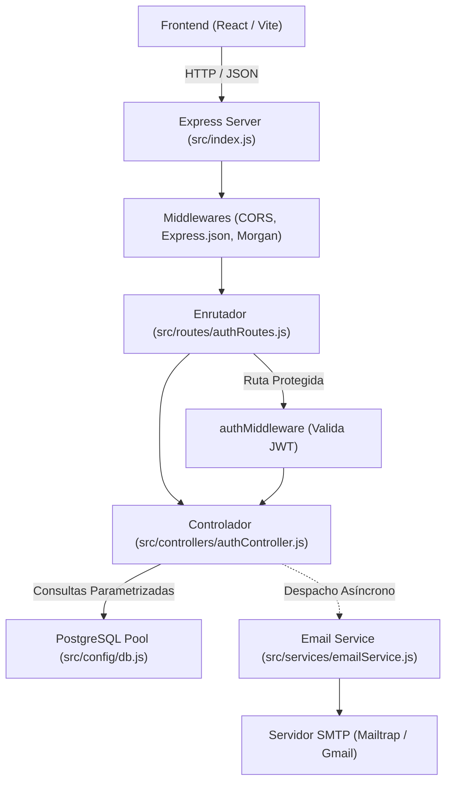

# Arquitectura y Guía Técnica del Backend - VinCloud

> **Documento de Referencia Técnica para Desarrolladores y Agentes LLM**  
> Proyecto: Plataforma como Servicio (PaaS) - Almacenamiento en la Nube (*VinCloud*)  
> Contexto: Proyecto Final de Ingeniería de Software I - 6to Semestre, Universidad Rafael Landívar.

---

## 1. Visión General del Proyecto

VinCloud es una plataforma PaaS (Platform as a Service) orientada a Almacenamiento como Servicio (*Storage as a Service*). Permite a los usuarios registrarse, autenticarse, gestionar cuotas de almacenamiento y administrar recursos digitales en la nube.

> [!IMPORTANT]
> **REGLA CRÍTICA DEL PROYECTO (Verificada en Contexto_LLM.md):**  
> **NUNCA modificar la apariencia visual ni la estructura del Frontend (`Front_/`)**. Todas las integraciones y adaptaciones deben respetar el diseño y contratos existentes de la interfaz de usuario.

---

## 2. Stack Tecnológico del Backend

| Componente | Tecnología | Propósito |
| :--- | :--- | :--- |
| **Entorno de Ejecución** | Node.js (ES Modules, `"type": "module"`) | Plataforma de ejecución del servidor |
| **Framework Web** | Express v5.x | Enrutamiento RESTful, middlewares y control de peticiones |
| **Base de Datos** | PostgreSQL 16+ | Almacenamiento relacional de usuarios, roles, cuotas y archivos binarios |
| **Cliente de BD** | `pg` (node-postgres) | Conexión mediante pool optimizado y consultas parametrizadas |
| **Autenticación** | `jsonwebtoken` (JWT) | Generación y verificación de tokens stateless |
| **Seguridad de Claves** | `bcryptjs` | Algoritmo de hash unidireccional y salteo (10 rounds) |
| **Correos Electrónicos** | `nodemailer` | Servicio de notificación SMTP (Mailtrap / Gmail) |
| **Procesamiento de Archivos**| `multer` | Manejo de cargas binarias multiparte (`multipart/form-data`) |
| **Utilidades** | `cors`, `dotenv`, `morgan` | Control de orígenes cruzados, variables de entorno y logging HTTP |

---

## 3. Estructura de Directorios

```text
Servicio-de-Almacenamiento/
├── Contexto_LLM.md               # Directrices maestras del proyecto
├── ARQUITECTURA_BACKEND.md       # Este documento técnico
├── README.md                     # Información general del repositorio
├── docs/                         # Documentación de diseño, UML y manuales
│   ├── 01-requisitos/
│   ├── 02-diseno/                # Diagramas de arquitectura, ER y UML
│   ├── 03-manuales/              # Guías técnicas (GUIA_MULTER_Y_TECNOLOGIAS.md)
│   └── 04-mockups/               # Prototipos y capturas de Figma
├── database/                     # Definición y scripts SQL de la base de datos
│   ├── inicializacion/
│   │   └── schema.sql            # Definición DDL (tablas rol, usuario, constraints)
│   └── datos-iniciales/
│       └── seed.sql              # Inserción de datos iniciales (roles por defecto)
└── Back_/                        # Código fuente del Backend
    ├── .env.example              # Plantilla de variables de entorno requeridas
    ├── package.json              # Dependencias y scripts de ejecución
    ├── Pruebas_Front/            # Borradores HTML temporales para probar funcionalidades antes de integrarse al frontend
    │   ├── Contexto-o-Orientacion.md # Directrices de pruebas temporales de interfaz
    │   └── verificacion-correo.html # Borrador funcional para validación y reenvío de correo
    └── src/
        ├── index.js              # Inicialización de la aplicación Express y middlewares globales
        ├── config/
        │   ├── db.js             # Pool de PostgreSQL y función helper query()
        │   └── mail.js           # Transporter SMTP de Nodemailer
        ├── controllers/
        │   └── authController.js # Lógica de negocio (register, login, getProfile, verifyEmail, resendVerification)
        ├── middlewares/
        │   └── authMiddleware.js # Middleware de validación de JWT (authenticateToken)
        ├── routes/
        │   └── authRoutes.js     # Rutas REST de autenticación (/api/auth)
        ├── services/
        │   └── emailService.js   # Generación de templates HTML y despacho de correos (bienvenida y verificación)
        └── scripts/
            ├── initDb.js         # Automatización de creación de BD, schema y seed
            └── testEmail.js      # Verificación y pruebas del transporte SMTP

```

---

## 4. Base de Datos y Modelo de Datos

La base de datos relacional se gestiona en PostgreSQL bajo el nombre `almacenamiento_db`.

### 4.1. Tablas y Restricciones ([`schema.sql`](file:///C:/Users/andre/OneDrive/Documentos/GitHub/Servicio-de-Almacenamiento/database/inicializacion/schema.sql))

#### Tabla `rol`
Representa los niveles de privilegios dentro de la plataforma.
- `id` (`INTEGER GENERATED ALWAYS AS IDENTITY`): Llave primaria.
- `nombre` (`VARCHAR(50) NOT NULL UNIQUE`): Nombre del rol (`'Administrador'`, `'Usuario'`).

#### Tabla `usuario`
Representa las cuentas de usuario registradas.
- `id` (`INTEGER GENERATED ALWAYS AS IDENTITY`): Llave primaria.
- `rol_id` (`INTEGER NOT NULL`): Llave foránea hacia `rol(id)`.
- `nombre` (`VARCHAR(100) NOT NULL`): Nombre completo del usuario.
- `correo` (`VARCHAR(150) NOT NULL UNIQUE`): Correo electrónico del usuario.
- `contrasena_hash` (`VARCHAR(255) NOT NULL`): Hash de la contraseña con bcrypt.
- `fecha_registro` (`DATE NOT NULL DEFAULT CURRENT_DATE`): Fecha de alta en el sistema.
- `correo_verificado` (`BOOLEAN NOT NULL DEFAULT FALSE`): Bandera de verificación.
- `nivel_acceso` (`VARCHAR(50) NOT NULL`): Nivel asignado (`'estandar'`).
- `espacio_consumido` (`BIGINT NOT NULL DEFAULT 0 CHECK (espacio_consumido >= 0)`): Bytes consumidos.
- `espacio_disponible` (`BIGINT NOT NULL DEFAULT 0 CHECK (espacio_disponible >= 0)`): Bytes totales asignados (5 GB por defecto = `5,368,709,120` bytes).

---

## 5. Arquitectura por Capas del Backend



### 5.1. Servidor Principal ([`src/index.js`](file:///C:/Users/andre/OneDrive/Documentos/GitHub/Servicio-de-Almacenamiento/Back_/src/index.js))
- Configura CORS para permitir solicitudes del cliente web.
- Configura el parseo de cuerpos JSON con límite seguro.
- Registra logs con `morgan('dev')` en entornos que no sean de producción.
- Expone ruta de Health Check: `GET /api/health`.
- Conecta el enrutador `/api/auth`.
- Implementa control centralizado para respuestas `404 Not Found` y manejo de excepciones no capturadas `500 Internal Server Error`.

### 5.2. Conexión a Base de Datos ([`src/config/db.js`](file:///C:/Users/andre/OneDrive/Documentos/GitHub/Servicio-de-Almacenamiento/Back_/src/config/db.js))
- Utiliza `pg.Pool` con límite de 20 clientes concurrentes e `idleTimeoutMillis` de 30 segundos.
- Provee la función utilitaria `query(text, params)` para ejecutar sentencias preparadas de forma limpia y segura contra inyecciones SQL.

### 5.3. Módulo de Autenticación ([`src/controllers/authController.js`](file:///C:/Users/andre/OneDrive/Documentos/GitHub/Servicio-de-Almacenamiento/Back_/src/controllers/authController.js))
- **Registro (`register`):**
  1. Sanitiza y valida formato de correo electrónico y longitud mínima de contraseña (6 caracteres).
  2. Verifica que el correo no exista en la tabla `usuario`.
  3. Resuelve dinámicamente el `rol_id` según el tipo de cuenta solicitado (`tipoCuenta`, `rol`: `'Administrador'` o `'Usuario'/'Cliente'`). Si se solicita cuenta de administrador, asigna automáticamente el rol `"Administrador"` y nivel de acceso `"administrador"`. Por defecto o para cuentas estándar asigna `"Usuario"` y nivel `"estandar"`.
  4. Genera el hash de la contraseña usando `bcrypt.hash(..., 10)`.
  5. Inserta el registro asignando la cuota estándar inicial de 5 GB (`5 * 1024 * 1024 * 1024` bytes) y `correo_verificado = FALSE`.
  6. Emite un JWT de sesión con expiración configurable (por defecto 7 días).
  7. Genera un token JWT específico de verificación (`type: 'verify_email'`, expiración 24 horas).
  8. Despacha en segundo plano y de manera no bloqueante el correo de verificación (`sendVerificationEmail`) y el correo de bienvenida (`sendWelcomeEmail`).
- **Inicio de Sesión (`login`):**
  1. Sanitiza y valida formato de correo con expresión regular (`EMAIL_REGEX`) y contraseña no vacía previo a cualquier consulta a la base de datos (cumpliendo con la etapa *"Validación expresiones regulares"* del Diagrama de Actividad UML).
  2. Consulta el usuario y realiza un `JOIN` con la tabla `rol`.
  3. Compara la contraseña mediante `bcrypt.compare`.
  4. Si la petición solicita un rol específico (`tipoCuenta`: `'administrador'`), valida que la cuenta posea dichos privilegios.
  5. Firma el token JWT con los claims `{ id, correo, nombre, rol }`.
  6. Retorna el token y los datos de perfil (incluyendo `correoVerificado`, `rol` y `nivelAcceso`), notificando en el mensaje de respuesta si la cuenta requiere verificar su correo electrónico.
- **Consulta de Perfil (`getProfile` / `/me`):**
  1. Extrae el `id` decodificado del token por el middleware.
  2. Devuelve los datos frescos del usuario desde la base de datos (espacio consumido, espacio disponible, rol y `correoVerificado`).
- **Verificación de Correo (`verifyEmail`):**
  1. Recibe el token por parámetro de consulta (`GET ?token=...`) o en el cuerpo JSON (`POST { token }`).
  2. Valida la firma del token JWT y su propósito (`type: 'verify_email'`).
  3. Actualiza el registro en la base de datos marcando `correo_verificado = TRUE`.
  4. Si la petición proviene de un navegador web (`Accept: text/html`), responde con una página HTML responsiva confirmando el éxito. Si es llamada vía API (`JSON`), responde con `{ verified: true, user }`.
- **Reenvío de Verificación (`resendVerification`):**
  1. Recibe el correo electrónico (`POST { correo }`).
  2. Comprueba que el usuario exista y que no esté previamente verificado.
  3. Genera un nuevo token de 24h y despacha el correo de verificación nuevamente.
- **Recuperación de Contraseña (`forgotPassword` y `resetPassword`):**
  1. `forgotPassword`: Valida el correo con `EMAIL_REGEX`. Si el usuario existe, genera un token JWT temporal (`type: 'reset_password'`, 1 hora de validez) y despacha un correo con botón y enlace seguro de restablecimiento (`sendPasswordResetEmail`).
  2. `resetPassword`: Valida el token JWT, verifica su expiración, exige al menos 6 caracteres para la nueva contraseña, calcula el nuevo hash con `bcrypt` (10 rounds) y actualiza el campo `contrasena_hash` en PostgreSQL.

### 5.4. Middleware de Seguridad ([`src/middlewares/authMiddleware.js`](file:///C:/Users/andre/OneDrive/Documentos/GitHub/Servicio-de-Almacenamiento/Back_/src/middlewares/authMiddleware.js))
- Valida la presencia del header `Authorization: Bearer <token>`.
- Verifica la validez y expiración del JWT contra la clave `JWT_SECRET`.
- Inyecta la identidad verificada en `req.user` para su disponibilidad en las siguientes capas.

### 5.5. Servicio de Correo ([`src/services/emailService.js`](file:///C:/Users/andre/OneDrive/Documentos/GitHub/Servicio-de-Almacenamiento/Back_/src/services/emailService.js))
- Posee la función `isEmailConfigured()` que detecta si el token de Mailtrap o contraseña SMTP está disponible.
- Si las credenciales no están presentes, opera en modo **simulación transparente** (no interrumpe el flujo ni arroja excepciones bloqueantes).
- **`sendWelcomeEmail(destinatario, nombre)`**: Notificación de bienvenida con cuota asignada e identidad visual de VinCloud (`#3B0A1F`, `#7D1535`).
- **`sendVerificationEmail(destinatario, nombre, token)`**: Correo con botón y enlace de activación (`GET /api/auth/verify?token=...`), más el token en texto para validación manual en interfaces de prueba.
- **`sendPasswordResetEmail(destinatario, nombre, token)`**: Correo con botón y enlace para restablecer la contraseña (`/?resetToken=...`), más el código para ingreso manual en la aplicación.

---

## 6. Especificación de Endpoints (API REST)

### Base URL: `http://localhost:5000/api`

| Método | Endpoint | Autenticación | Descripción |
| :--- | :--- | :--- | :--- |
| `GET` | `/health` | Pública | Verifica el estado del servidor y timestamp actual |
| `POST` | `/auth/register` | Pública | Registra un nuevo usuario, emite tokens y despacha correos |
| `POST` | `/auth/login` | Pública | Autentica credenciales con validación regex y emite token JWT |
| `GET` | `/auth/me` | Requerida (Bearer Token) | Devuelve perfil, cuota y estado de verificación (`correoVerificado`) |
| `GET` | `/auth/verify` | Pública (`?token=...`) | Valida el token desde el enlace del correo; renderiza HTML o responde JSON |
| `POST` | `/auth/verify` | Pública | Valida el token enviado por JSON `{ token }` |
| `POST` | `/auth/resend-verification` | Pública | Reenvía correo con nuevo token si la cuenta no ha sido verificada |
| `POST` | `/auth/forgot-password` | Pública | Envía correo con token para restablecer contraseña |
| `POST` | `/auth/reset-password` | Pública | Restablece la contraseña con token válido y nueva clave |

#### Ejemplo de Petición: `POST /api/auth/register`
```json
{
  "nombre": "Juan Pérez",
  "correo": "juan.perez@example.com",
  "contrasena": "Secreta123",
  "tipoCuenta": "Administrador"
}
```
*(Nota: El campo `tipoCuenta` es opcional; si se omite, se asigna automáticamente `"Usuario"`).*

#### Ejemplo de Respuesta Exitosa (`201 Created`):
```json
{
  "message": "Usuario registrado exitosamente. Se ha enviado un correo para verificar tu cuenta.",
  "token": "eyJhbGciOiJIUzI1NiIsInR5cCI6IkpXVCJ9...",
  "verificationToken": "eyJhbGciOiJIUzI1NiIsInR5cCI6IkpXVCJ9...",
  "user": {
    "id": 1,
    "nombre": "Juan Pérez",
    "correo": "juan.perez@example.com",
    "rol": "Usuario",
    "nivelAcceso": "estandar",
    "correoVerificado": false,
    "espacioConsumido": 0,
    "espacioDisponible": 5368709120,
    "fechaRegistro": "2026-10-11T00:00:00.000Z"
  }
}
```

#### Ejemplo de Petición: `POST /api/auth/verify`
```json
{
  "token": "eyJhbGciOiJIUzI1NiIsInR5cCI6IkpXVCJ9.token_de_verificacion..."
}
```

#### Ejemplo de Respuesta Exitosa (`200 OK`):
```json
{
  "message": "Correo verificado exitosamente.",
  "verified": true,
  "user": {
    "id": 1,
    "nombre": "Juan Pérez",
    "correo": "juan.perez@example.com",
    "correoVerificado": true
  }
}
```

#### Ejemplo de Petición: `POST /api/auth/resend-verification`
```json
{
  "correo": "juan.perez@example.com"
}
```

---

## 7. Variables de Entorno (`Back_/.env`)

Crea un archivo `.env` dentro de la carpeta `Back_/` basado en `Back_/.env.example`:

```env
# Puerto del servidor
PORT=5000

# PostgreSQL
DB_HOST=localhost
DB_PORT=5432
DB_USER=postgres
DB_PASSWORD=tu_contrasena
DB_NAME=almacenamiento_db

# Seguridad
JWT_SECRET=tu_clave_secreta_jwt
JWT_EXPIRES_IN=7d
NODE_ENV=development

# Correo (Opción Sandbox para desarrollo)
SMTP_HOST=sandbox.smtp.mailtrap.io
SMTP_PORT=2525
SMTP_USER=tu_usuario_sandbox
SMTP_PASS=tu_password_sandbox
EMAIL_FROM="VinCloud <notificaciones@vincloud.com>"
```

---

## 8. Guía de Ejecución y Scripts Disponibles

Desde el directorio `Back_/`:

1. **Instalar dependencias:**
   ```bash
   npm install
   ```

2. **Inicializar Base de Datos (crea `almacenamiento_db`, tablas y roles iniciales):**
   ```bash
   npm run db:init
   ```

3. **Iniciar el Servidor en Modo Desarrollo (recarga automática con Node.js):**
   ```bash
   npm run dev
   ```

4. **Probar el servicio de correo electrónico:**
   ```bash
   # Prueba correo de bienvenida con SMTP de .env
   npm run test:email

   # Vista previa en navegador de bienvenida (Ethereal)
   npm run test:email:preview

   # Prueba correo de verificación con SMTP de .env
   npm run test:email:verify

   # Vista previa en navegador de verificación (Ethereal)
   npm run test:email:verify:preview
   ```

---

## 9. Prototipos de Frontend (`Back_/Pruebas_Front/`)

Para probar flujos de usuario antes de que el equipo de frontend desarrolle las pantallas definitivas en React (respetando la regla de no modificar el frontend principal):

- [`verificacion-correo.html`](file:///C:/Users/andre/OneDrive/Documentos/GitHub/Servicio-de-Almacenamiento/Back_/Pruebas_Front/verificacion-correo.html): Archivo HTML independiente que contiene el formulario para ingresar tokens de verificación, detectar tokens desde URL y solicitar el reenvío de correos conectándose en vivo a la API (`http://localhost:5000/api/auth`).
- [`registro-roles.html`](file:///C:/Users/andre/OneDrive/Documentos/GitHub/Servicio-de-Almacenamiento/Back_/Pruebas_Front/registro-roles.html): Prototipo independiente para probar la creación de cuentas con selección dinámica de rol (Administrador vs Usuario) y validación de inicio de sesión según el rol asignado.

