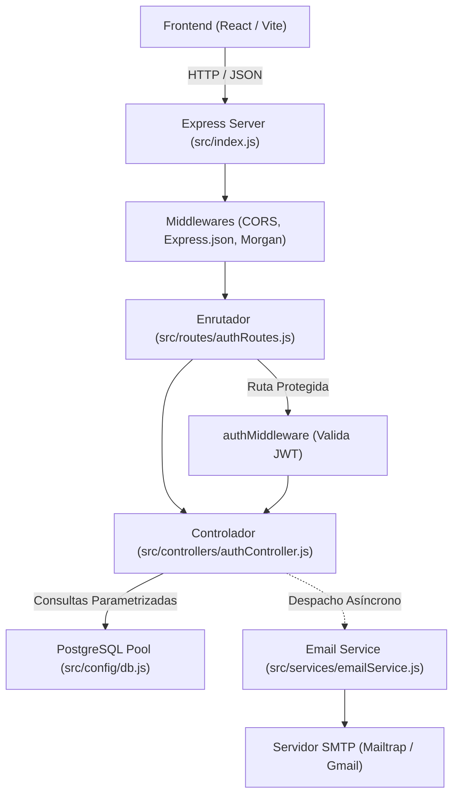

# Arquitectura y Guía Técnica del Backend - VinCloud

> **Documento de Referencia Técnica para Desarrolladores y Agentes LLM**  
> Proyecto: Plataforma como Servicio (PaaS) - Almacenamiento en la Nube (*VinCloud*)  
> Contexto: Proyecto Final de Ingeniería de Software I - 6to Semestre, Universidad Rafael Landívar.

---

## 1. Visión General del Proyecto

VinCloud es una plataforma PaaS (Platform as a Service) orientada a Almacenamiento como Servicio (*Storage as a Service*). Permite a los usuarios registrarse, autenticarse, gestionar cuotas de almacenamiento y administrar recursos digitales en la nube.

> [!IMPORTANT]
> **REGLA CRÍTICA DEL PROYECTO (Verificada en Contexto_LLM.md):**  
> **NUNCA modificar la apariencia visual ni la estructura del Frontend (`Front_/`)**. Todas las integraciones y adaptaciones deben respetar el diseño y contratos existentes de la interfaz de usuario.

---

## 2. Stack Tecnológico del Backend

| Componente | Tecnología | Propósito |
| :--- | :--- | :--- |
| **Entorno de Ejecución** | Node.js (ES Modules, `"type": "module"`) | Plataforma de ejecución del servidor |
| **Framework Web** | Express v5.x | Enrutamiento RESTful, middlewares y control de peticiones |
| **Base de Datos** | PostgreSQL 16+ | Almacenamiento relacional de usuarios, roles, cuotas y archivos binarios |
| **Cliente de BD** | `pg` (node-postgres) | Conexión mediante pool optimizado y consultas parametrizadas |
| **Autenticación** | `jsonwebtoken` (JWT) | Generación y verificación de tokens stateless |
| **Seguridad de Claves** | `bcryptjs` | Algoritmo de hash unidireccional y salteo (10 rounds) |
| **Correos Electrónicos** | `nodemailer` | Servicio de notificación SMTP (Mailtrap / Gmail) |
| **Procesamiento de Archivos**| `multer` | Manejo de cargas binarias multiparte (`multipart/form-data`) |
| **Utilidades** | `cors`, `dotenv`, `morgan` | Control de orígenes cruzados, variables de entorno y logging HTTP |

---

## 3. Estructura de Directorios

```text
Servicio-de-Almacenamiento/
├── Contexto_LLM.md               # Directrices maestras del proyecto
├── ARQUITECTURA_BACKEND.md       # Este documento técnico
├── README.md                     # Información general del repositorio
├── docs/                         # Documentación de diseño, UML y manuales
│   ├── 01-requisitos/
│   ├── 02-diseno/                # Diagramas de arquitectura, ER y UML
│   ├── 03-manuales/              # Guías técnicas (GUIA_MULTER_Y_TECNOLOGIAS.md, GUIA_USO_API.md)
│   └── 04-mockups/               # Prototipos y capturas de Figma
├── database/                     # Definición y scripts SQL de la base de datos
│   ├── inicializacion/
│   │   └── schema.sql            # Definición DDL (tablas rol, usuario, constraints)
│   └── datos-iniciales/
│       └── seed.sql              # Inserción de datos iniciales (roles por defecto)
└── Back_/                        # Código fuente del Backend
    ├── .env.example              # Plantilla de variables de entorno requeridas
    ├── package.json              # Dependencias y scripts de ejecución
    ├── Pruebas_Front/            # Borradores HTML temporales para probar funcionalidades antes de integrarse al frontend
    │   ├── Contexto-o-Orientacion.md # Directrices de pruebas temporales de interfaz
    │   ├── verificacion-correo.html  # Borrador funcional para validación y reenvío de correo
    │   ├── registro-roles.html       # Borrador para probar registro e inicio de sesión con roles
    │   ├── subida-archivos.html      # Borrador para probar almacenamiento, carpetas, papelera e invitaciones
    │   └── panel-administrador.html  # Borrador para probar gestión administrativa, planes y reportes
    └── src/
        ├── app.js                # Configuración de Express y montaje de rutas (/api/auth, /api/storage, /api/admin)
        ├── index.js              # Arranque del servidor y validación de variables de entorno
        ├── config/
        │   ├── constants.js      # Reglas de negocio (cuotas, roles, propósitos de token, límites)
        │   ├── db.js             # Pool de PostgreSQL y función helper query()
        │   ├── env.js            # Carga única de variables de entorno
        │   └── mail.js           # Transporter SMTP de Nodemailer
        ├── controllers/
        │   ├── authController.js    # Controlador HTTP de autenticación
        │   ├── storageController.js # Controlador HTTP de almacenamiento, papelera e invitaciones
        │   └── adminController.js   # Controlador HTTP del rol Administrador
        ├── middlewares/
        │   ├── authMiddleware.js     # Validación de JWT (authenticateToken) y rol Administrador (requireAdmin)
        │   ├── errorHandler.js       # Manejo centralizado de 404 y errores HTTP
        │   └── uploadMiddleware.js   # Carga y almacenamiento en disco con Multer
        ├── repositories/
        │   ├── userRepository.js     # Consultas SQL de usuarios y cuotas de almacenamiento
        │   ├── fileRepository.js     # Consultas SQL para archivos (CRUD, búsquedas, recientes, papelera)
        │   ├── folderRepository.js   # Consultas SQL para carpetas (jerarquías, conteo recursivo)
        │   └── adminRepository.js    # Consultas SQL de administración (clientes, planes, reportes)
        ├── routes/
        │   ├── authRoutes.js         # Rutas REST de autenticación (/api/auth)
        │   ├── storageRoutes.js      # Rutas REST de almacenamiento (/api/storage)
        │   └── adminRoutes.js        # Rutas REST de administración (/api/admin)
        ├── services/
        │   ├── accountService.js     # Verificación de correo y recuperación de contraseñas
        │   ├── authService.js        # Lógica de registro, login, asignación de roles y perfil
        │   ├── emailService.js       # Generación de templates HTML y despacho de correos
        │   ├── passwordService.js    # Hashing y validación de contraseñas con bcrypt
        │   ├── storageService.js     # Lógica de almacenamiento, cuotas, papelera e invitaciones
        │   ├── adminService.js       # Lógica de administración de usuarios, planes y reportes
        │   └── tokenService.js       # Firma y validación de tokens JWT de sesión y propósito
        ├── templates/                # Plantillas HTML de correos (bienvenida, verificación, reset, invitación)
        ├── utils/                    # Utilidades (httpError.js, escapeHtml.js)
        ├── validators/               # Validación de entrada (authValidator, storageValidator, adminValidator)
        └── scripts/
            ├── initDb.js             # Automatización de creación de BD, schema y seed
            └── testEmail.js          # Verificación y pruebas del transporte SMTP
```

---

## 4. Base de Datos y Modelo de Datos

La base de datos relacional se gestiona en PostgreSQL bajo el nombre `almacenamiento_db`.

### 4.1. Tablas y Restricciones ([`schema.sql`](file:///C:/Users/andre/OneDrive/Documentos/GitHub/Servicio-de-Almacenamiento/database/inicializacion/schema.sql))

#### Tabla `rol`
Representa los niveles de privilegios dentro de la plataforma.
- `id` (`INTEGER GENERATED ALWAYS AS IDENTITY`): Llave primaria.
- `nombre` (`VARCHAR(50) NOT NULL UNIQUE`): Nombre del rol (`'Administrador'`, `'Usuario'`).

#### Tabla `usuario`
Representa las cuentas de usuario registradas.
- `id` (`INTEGER GENERATED ALWAYS AS IDENTITY`): Llave primaria.
- `rol_id` (`INTEGER NOT NULL`): Llave foránea hacia `rol(id)`.
- `nombre` (`VARCHAR(100) NOT NULL`): Nombre completo del usuario.
- `correo` (`VARCHAR(150) NOT NULL UNIQUE`): Correo electrónico del usuario.
- `contrasena_hash` (`VARCHAR(255) NOT NULL`): Hash de la contraseña con bcrypt.
- `fecha_registro` (`DATE NOT NULL DEFAULT CURRENT_DATE`): Fecha de alta en el sistema.
- `correo_verificado` (`BOOLEAN NOT NULL DEFAULT FALSE`): Bandera de verificación.
- `nivel_acceso` (`VARCHAR(50) NOT NULL`): Nivel asignado (`'estandar'`).
- `espacio_consumido` (`BIGINT NOT NULL DEFAULT 0 CHECK (espacio_consumido >= 0)`): Bytes consumidos.
- `espacio_disponible` (`BIGINT NOT NULL DEFAULT 0 CHECK (espacio_disponible >= 0)`): Bytes totales asignados (5 GB por defecto = `5,368,709,120` bytes).

#### Tabla `carpeta`
Representa la estructura jerárquica de directorios del usuario.
- `id` (`INTEGER GENERATED ALWAYS AS IDENTITY`): Llave primaria.
- `usuario_id` (`INTEGER NOT NULL`): Llave foránea hacia `usuario(id)` con `ON DELETE CASCADE`.
- `carpeta_padre_id` (`INTEGER`): Llave foránea recursiva hacia `carpeta(id)` con `ON DELETE CASCADE` (`NULL` para la raíz).
- `nombre` (`VARCHAR(255) NOT NULL`): Nombre de la carpeta.
- `fecha_creacion` (`DATE NOT NULL DEFAULT CURRENT_DATE`): Fecha de creación.

#### Tabla `archivo`
Representa los archivos subidos por el usuario a una carpeta o al directorio raíz.
- `id` (`INTEGER GENERATED ALWAYS AS IDENTITY`): Llave primaria.
- `usuario_id` (`INTEGER NOT NULL`): Llave foránea hacia `usuario(id)` con `ON DELETE CASCADE`.
- `carpeta_id` (`INTEGER`): Llave foránea hacia `carpeta(id)` con `ON DELETE CASCADE` (`NULL` si se ubica en la raíz).
- `nombre` (`VARCHAR(255) NOT NULL`): Nombre original del archivo.
- `tamano` (`BIGINT NOT NULL CHECK (tamano >= 0)`): Tamaño en bytes del archivo.
- `tipo` (`VARCHAR(100) NOT NULL`): Tipo de archivo o MIME type.
- `fecha_subida` (`DATE NOT NULL DEFAULT CURRENT_DATE`): Fecha en que se completó la subida.
- `en_papelera` (`BOOLEAN NOT NULL DEFAULT FALSE`): Indica si el archivo fue enviado a la papelera (borrado lógico).
- `fecha_eliminacion` (`DATE`): Fecha en que el archivo fue movido a la papelera (`NULL` si está activo).

#### Tablas y Vistas de Soporte de Planes, Suscripciones y Pagos
- `plan`: Catálogo de planes (`id`, `nombre`, `descripcion`, `precio`, `capacidad_almacenamiento`, `vigencia_dias`, `activo`).
- `suscripcion`: Contratación de planes por usuario (`id`, `usuario_id`, `plan_id`, `fecha_inicio`, `fecha_renovacion`, `estado` en `'pendiente' | 'activa' | 'vencida' | 'cancelada'`, con índice único parcial `uq_suscripcion_activa_por_usuario`).
- `pago`: Registro de transacciones asociadas a la suscripción (`id`, `usuario_id`, `suscripcion_id`, `monto`, `fecha` `TIMESTAMPTZ`, `estado` en `'pendiente' | 'aprobado' | 'rechazado'`, `tipo` en `'contratacion' | 'renovacion'`, `referencia`, `tarjeta_ultimos4`).
- Vistas: `v_historial_pagos` (historial detallado de pagos por usuario) y `v_suscripcion_actual` (suscripción activa con datos del plan y `dias_restantes`).

---

## 5. Arquitectura por Capas del Backend



### 5.1. Servidor Principal ([`src/index.js`](file:///C:/Users/andre/OneDrive/Documentos/GitHub/Servicio-de-Almacenamiento/Back_/src/index.js))
- Configura CORS para permitir solicitudes del cliente web.
- Configura el parseo de cuerpos JSON con límite seguro.
- Registra logs con `morgan('dev')` en entornos que no sean de producción.
- Expone ruta de Health Check: `GET /api/health`.
- Conecta el enrutador `/api/auth`.
- Implementa control centralizado para respuestas `404 Not Found` y manejo de excepciones no capturadas `500 Internal Server Error`.

### 5.2. Conexión a Base de Datos ([`src/config/db.js`](file:///C:/Users/andre/OneDrive/Documentos/GitHub/Servicio-de-Almacenamiento/Back_/src/config/db.js))
- Utiliza `pg.Pool` con límite de 20 clientes concurrentes e `idleTimeoutMillis` de 30 segundos.
- Provee la función utilitaria `query(text, params)` para ejecutar sentencias preparadas de forma limpia y segura contra inyecciones SQL.

### 5.3. Módulo de Autenticación ([`src/controllers/authController.js`](file:///C:/Users/andre/OneDrive/Documentos/GitHub/Servicio-de-Almacenamiento/Back_/src/controllers/authController.js))
- **Registro (`register`):**
  1. Sanitiza y valida formato de correo electrónico y longitud mínima de contraseña (6 caracteres).
  2. Verifica que el correo no exista en la tabla `usuario`.
  3. Resuelve dinámicamente el `rol_id` según el tipo de cuenta solicitado (`tipoCuenta`, `rol`: `'Administrador'` o `'Usuario'/'Cliente'`). Si se solicita cuenta de administrador, asigna automáticamente el rol `"Administrador"` y nivel de acceso `"administrador"`. Por defecto o para cuentas estándar asigna `"Usuario"` y nivel `"estandar"`.
  4. Genera el hash de la contraseña usando `bcrypt.hash(..., 10)`.
  5. Inserta el registro asignando la cuota estándar inicial de 5 GB (`5 * 1024 * 1024 * 1024` bytes) y `correo_verificado = FALSE`.
  6. Emite un JWT de sesión con expiración configurable (por defecto 7 días).
  7. Genera un token JWT específico de verificación (`type: 'verify_email'`, expiración 24 horas).
  8. Despacha en segundo plano y de manera no bloqueante el correo de verificación (`sendVerificationEmail`) y el correo de bienvenida (`sendWelcomeEmail`).
- **Inicio de Sesión (`login`):**
  1. Sanitiza y valida formato de correo con expresión regular (`EMAIL_REGEX`) y contraseña no vacía previo a cualquier consulta a la base de datos (cumpliendo con la etapa *"Validación expresiones regulares"* del Diagrama de Actividad UML).
  2. Consulta el usuario y realiza un `JOIN` con la tabla `rol`.
  3. Compara la contraseña mediante `bcrypt.compare`.
  4. Si la petición solicita un rol específico (`tipoCuenta`: `'administrador'`), valida que la cuenta posea dichos privilegios.
  5. Firma el token JWT con los claims `{ id, correo, nombre, rol }`.
  6. Retorna el token y los datos de perfil (incluyendo `correoVerificado`, `rol` y `nivelAcceso`), notificando en el mensaje de respuesta si la cuenta requiere verificar su correo electrónico.
- **Consulta de Perfil (`getProfile` / `/me`):**
  1. Extrae el `id` decodificado del token por el middleware.
  2. Devuelve los datos frescos del usuario desde la base de datos (espacio consumido, espacio disponible, rol y `correoVerificado`).
- **Verificación de Correo (`verifyEmail`):**
  1. Recibe el token por parámetro de consulta (`GET ?token=...`) o en el cuerpo JSON (`POST { token }`).
  2. Valida la firma del token JWT y su propósito (`type: 'verify_email'`).
  3. Actualiza el registro en la base de datos marcando `correo_verificado = TRUE`.
  4. Si la petición proviene de un navegador web (`Accept: text/html`), responde con una página HTML responsiva confirmando el éxito. Si es llamada vía API (`JSON`), responde con `{ verified: true, user }`.
- **Reenvío de Verificación (`resendVerification`):**
  1. Recibe el correo electrónico (`POST { correo }`).
  2. Comprueba que el usuario exista y que no esté previamente verificado.
  3. Genera un nuevo token de 24h y despacha el correo de verificación nuevamente.
- **Recuperación de Contraseña (`forgotPassword` y `resetPassword`):**
  1. `forgotPassword`: Valida el correo con `EMAIL_REGEX`. Si el usuario existe, genera un token JWT temporal (`type: 'reset_password'`, 1 hora de validez) y despacha un correo con botón y enlace seguro de restablecimiento (`sendPasswordResetEmail`).
  2. `resetPassword`: Valida el token JWT, verifica su expiración, exige al menos 6 caracteres para la nueva contraseña, calcula el nuevo hash con `bcrypt` (10 rounds) y actualiza el campo `contrasena_hash` en PostgreSQL.

### 5.4. Middleware de Seguridad ([`src/middlewares/authMiddleware.js`](file:///C:/Users/andre/OneDrive/Documentos/GitHub/Servicio-de-Almacenamiento/Back_/src/middlewares/authMiddleware.js))
- **`authenticateToken`**: Valida la presencia del header `Authorization: Bearer <token>`, verifica la validez y expiración del JWT contra `JWT_SECRET`, e inyecta la identidad verificada en `req.user`.
- **`requireAdmin`**: Comprueba que `req.user.rol` corresponda a `'Administrador'` (implementando la etapa *"Verifica permisos de administrador"* del Diagrama de Actividad UML). Si no cuenta con privilegios, rechaza la petición con `403 Forbidden`.

### 5.5. Servicio de Correo ([`src/services/emailService.js`](file:///C:/Users/andre/OneDrive/Documentos/GitHub/Servicio-de-Almacenamiento/Back_/src/services/emailService.js))
- Posee la función `isEmailConfigured()` que detecta si el token de Mailtrap o contraseña SMTP está disponible.
- Si las credenciales no están presentes, opera en modo **simulación transparente** (no interrumpe el flujo ni arroja excepciones bloqueantes).
- **`sendWelcomeEmail(destinatario, nombre)`**: Notificación de bienvenida con cuota asignada e identidad visual de VinCloud (`#3B0A1F`, `#7D1535`).
- **`sendVerificationEmail(destinatario, nombre, token)`**: Correo con botón y enlace de activación (`GET /api/auth/verify?token=...`), más el token en texto para validación manual en interfaces de prueba.
- **`sendPasswordResetEmail(destinatario, nombre, token)`**: Correo con botón y enlace para restablecer la contraseña (`/?resetToken=...`), más el código para ingreso manual en la aplicación.
- **`sendShareInvitationEmail(...)`**: Correo de invitación para visualizar o descargar un archivo compartido.

### 5.6. Middleware de Carga de Archivos ([`src/middlewares/uploadMiddleware.js`](file:///C:/Users/andre/OneDrive/Documentos/GitHub/Servicio-de-Almacenamiento/Back_/src/middlewares/uploadMiddleware.js))
- Configura `multer.diskStorage` apuntando al directorio de subidas (`uploads/`).
- Genera identificadores únicos por archivo (`Date.now() - crypto.randomUUID()`) preservando su extensión para evitar colisiones.
- Filtra extensiones potencialmente ejecutables o riesgosas (`.exe`, `.sh`, `.bat`, etc.) devolviendo un error `400`.
- Controla el límite de tamaño individual (100 MB por defecto) y transforma excepciones nativas de Multer (`MulterError`) en instancias seguras de `HttpError`.

### 5.7. Servicio de Almacenamiento ([`src/services/storageService.js`](file:///C:/Users/andre/OneDrive/Documentos/GitHub/Servicio-de-Almacenamiento/Back_/src/services/storageService.js))
Implementa las reglas de negocio del sistema de archivos, papelera, invitaciones y cuotas:
- **`uploadFile`**: Valida que la carpeta de destino pertenezca al usuario; comprueba la cuota disponible en PostgreSQL (`espacio_consumido + fileSize <= espacio_disponible`); inserta los metadatos en la tabla `archivo`; renombra el archivo físico en disco con su ID único (`<id>.<ext>`); e incrementa atómicamente el espacio consumido. Si la cuota se excede o la base de datos falla, elimina inmediatamente el archivo temporal del disco para evitar huérfanos.
- **`getFileForDownload`**: Comprueba permisos sobre el archivo y existencia física en disco antes de suministrarlo para su descarga en streaming o visualización inline.
- **`deleteFile` / `permanentDeleteFile` / `restoreFile` / `emptyTrash`**: Gestiona el ciclo de vida de la papelera (`en_papelera = TRUE`) y la eliminación definitiva liberando cuota y borrando el archivo físico del disco.
- **`renameFile`**: Valida y actualiza el nombre del archivo.
- **`getDirectoryContents`**: Recupera en paralelo carpetas y archivos para el nivel solicitado (raíz o subcarpeta).
- **`getRecentFiles`**: Devuelve los últimos archivos creados para la vista de Recientes.
- **`searchFiles`**: Realiza búsquedas insensible a mayúsculas sobre el nombre de archivos del usuario.
- **`createFolder` / `renameFolder` / `deleteFolder`**: Gestión de carpetas jerárquicas y borrado recursivo (`WITH RECURSIVE`) con liberación de cuota.
- **`createShareInvitation` / `getSharedFileInfo` / `getSharedFileForDownload`**: Generación y validación de enlaces de invitación (`TOKEN_PURPOSES.FILE_SHARE`) para el rol Invitado.

### 5.8. Servicio de Administración ([`src/services/adminService.js`](file:///C:/Users/andre/OneDrive/Documentos/GitHub/Servicio-de-Almacenamiento/Back_/src/services/adminService.js))
Implementa los casos de uso exclusivos del rol **Administrador** según el Diagrama de Casos de Uso, Diagrama de Clases (`Administrador` y `Reporte`) y Diagrama de Actividad:
- **`getUsers` / `updateUser` / `deleteUser` (`gestionarUsuarios()`)**: Lista todas las cuentas registradas con su consumo de almacenamiento, archivos, carpetas y suscripción activa; permite modificar la cuota (`espacio_disponible`), rol o estado de verificación de un cliente; y permite eliminar cuentas limpiando sus archivos físicos en disco.
- **`getPlans` / `createPlan` / `updatePlan` (`gestionarPlanes()`)**: Administra el catálogo de planes de almacenamiento en la tabla `plan`, permitiendo crear nuevos planes, editar precios/capacidades y activar o desactivar planes (`activo = FALSE`).
- **`getUserPlans`**: Implementa el Diagrama de Actividad *"Administrador visualiza planes de usuarios"*, devolviendo la lista de usuarios junto con los detalles de su plan contratado y consumo.
- **`generateReport` (`generarReporte(): Reporte`)**: Calcula en tiempo real las métricas globales de la plataforma (`fechaGeneracion`, `usuariosActivos`, `espacioTotalConsumido`, `ingresosSimulados`, más desglose por plan).

---

## 6. Especificación de Endpoints (API REST)

### Base URL: `http://localhost:5000/api`

| Método | Endpoint | Autenticación | Descripción |
| :--- | :--- | :--- | :--- |
| `GET` | `/health` | Pública | Verifica el estado del servidor y timestamp actual |
| `POST` | `/auth/register` | Pública | Registra un nuevo usuario (`tipoCuenta` opcional), emite tokens y despacha correos |
| `POST` | `/auth/login` | Pública | Autentica credenciales con validación regex y emite token JWT |
| `GET` | `/auth/me` | Requerida (Bearer Token) | Devuelve perfil, cuota y estado de verificación (`correoVerificado`) |
| `GET` | `/auth/verify` | Pública (`?token=...`) | Valida el token desde el enlace del correo |
| `POST` | `/auth/verify` | Pública | Valida el token enviado por JSON `{ token }` |
| `POST` | `/auth/verify-email` | Pública | Valida el token de verificación desde el frontend React |
| `POST` | `/auth/resend-verification` | Pública | Reenvía correo con nuevo token si la cuenta no ha sido verificada |
| `POST` | `/auth/forgot-password` | Pública | Envía correo con token para restablecer contraseña |
| `POST` | `/auth/reset-password` | Pública | Restablece la contraseña con token válido y nueva clave |
| `GET` | `/storage/shared/:token` | Pública (Invitado) | Obtiene metadatos de un archivo compartido mediante enlace de invitación |
| `GET` | `/storage/shared/:token/download` | Pública (Invitado) | Descarga o visualiza (`?inline=true`) un archivo compartido |
| `POST` | `/storage/upload` | Requerida (Bearer) | Sube un archivo con `multipart/form-data` y valida cuota |
| `GET` | `/storage/files` | Requerida (Bearer) | Lista carpetas y archivos (opcional `?carpetaId=...`) |
| `GET` | `/storage/files/recent` | Requerida (Bearer) | Obtiene los archivos más recientes (opcional `?limit=...`) |
| `GET` | `/storage/files/search` | Requerida (Bearer) | Busca archivos por coincidencia en el nombre (`?q=...`) |
| `GET` | `/storage/files/:id/view` | Requerida (Bearer) | Visualiza un archivo en modo inline en el navegador |
| `GET` | `/storage/files/:id/download` | Requerida (Bearer) | Descarga el archivo binario en streaming seguro |
| `POST` | `/storage/files/:id/share` | Requerida (Bearer) | Genera enlace de invitación y opcionalmente lo envía por correo |
| `PATCH` | `/storage/files/:id` | Requerida (Bearer) | Renombra un archivo (`{ nuevoNombre }`) |
| `DELETE` | `/storage/files/:id` | Requerida (Bearer) | Mueve un archivo a la papelera (o elimina con `?permanent=true`) |
| `GET` | `/storage/trash` | Requerida (Bearer) | Lista los archivos en la papelera del usuario |
| `DELETE` | `/storage/trash` | Requerida (Bearer) | Vacía toda la papelera y libera el espacio consumido |
| `POST` | `/storage/trash/:id/restore` | Requerida (Bearer) | Restaura un archivo desde la papelera |
| `DELETE` | `/storage/trash/:id` | Requerida (Bearer) | Elimina permanentemente un archivo de la papelera y libera cuota |
| `POST` | `/storage/folders` | Requerida (Bearer) | Crea una carpeta (`{ nombre, carpetaPadreId }`) |
| `PATCH` | `/storage/folders/:id` | Requerida (Bearer) | Renombra una carpeta (`{ nuevoNombre }`) |
| `DELETE` | `/storage/folders/:id` | Requerida (Bearer) | Elimina una carpeta y sus contenidos liberando cuota |
| `GET` | `/admin/reports` | Admin (Bearer + `requireAdmin`) | Genera el reporte general del servicio (`usuariosActivos`, `espacioTotalConsumido`, `ingresosSimulados`) |
| `GET` | `/admin/users` | Admin (Bearer + `requireAdmin`) | Lista todas las cuentas de clientes, su consumo y suscripción activa |
| `PATCH` | `/admin/users/:id` | Admin (Bearer + `requireAdmin`) | Actualiza rol, cuota (`espacioDisponible`/`cuotaGb`) o verificación de un usuario |
| `DELETE` | `/admin/users/:id` | Admin (Bearer + `requireAdmin`) | Elimina la cuenta de un cliente y limpia sus archivos en disco |
| `GET` | `/admin/user-plans` | Admin (Bearer + `requireAdmin`) | Visualiza la lista de planes y consumo por usuario (Diagrama de Actividad) |
| `GET` | `/admin/plans` | Admin (Bearer + `requireAdmin`) | Lista el catálogo completo de planes (activos e inactivos) |
| `POST` | `/admin/plans` | Admin (Bearer + `requireAdmin`) | Crea un nuevo plan en el catálogo (`nombre`, `precio`, `capacidadGb`, `vigenciaDias`) |
| `PATCH` | `/admin/plans/:id` | Admin (Bearer + `requireAdmin`) | Edita un plan o lo activa/desactiva (`{ activo: false }`) |

#### Ejemplo de Petición: `POST /api/auth/register`
```json
{
  "nombre": "Juan Pérez",
  "correo": "juan.perez@example.com",
  "contrasena": "Secreta123",
  "tipoCuenta": "Administrador"
}
```
*(Nota: El campo `tipoCuenta` es opcional; si se omite, se asigna automáticamente `"Usuario"`).*

#### Ejemplo de Respuesta Exitosa (`201 Created`):
```json
{
  "message": "Usuario registrado exitosamente. Se ha enviado un correo para verificar tu cuenta.",
  "token": "eyJhbGciOiJIUzI1NiIsInR5cCI6IkpXVCJ9...",
  "verificationToken": "eyJhbGciOiJIUzI1NiIsInR5cCI6IkpXVCJ9...",
  "user": {
    "id": 1,
    "nombre": "Juan Pérez",
    "correo": "juan.perez@example.com",
    "rol": "Usuario",
    "nivelAcceso": "estandar",
    "correoVerificado": false,
    "espacioConsumido": 0,
    "espacioDisponible": 5368709120,
    "fechaRegistro": "2026-10-11T00:00:00.000Z"
  }
}
```

#### Ejemplo de Petición: `POST /api/auth/verify`
```json
{
  "token": "eyJhbGciOiJIUzI1NiIsInR5cCI6IkpXVCJ9.token_de_verificacion..."
}
```

#### Ejemplo de Respuesta Exitosa (`200 OK`):
```json
{
  "message": "Correo verificado exitosamente.",
  "verified": true,
  "user": {
    "id": 1,
    "nombre": "Juan Pérez",
    "correo": "juan.perez@example.com",
    "correoVerificado": true
  }
}
```

#### Ejemplo de Petición: `POST /api/auth/resend-verification`
```json
{
  "correo": "juan.perez@example.com"
}
```

---

## 7. Variables de Entorno (`Back_/.env`)

Crea un archivo `.env` dentro de la carpeta `Back_/` basado en `Back_/.env.example`:

```env
# Puerto del servidor
PORT=5000

# PostgreSQL
DB_HOST=localhost
DB_PORT=5432
DB_USER=postgres
DB_PASSWORD=tu_contrasena
DB_NAME=almacenamiento_db

# Seguridad
JWT_SECRET=tu_clave_secreta_jwt
JWT_EXPIRES_IN=7d
NODE_ENV=development

# Correo (Opción Sandbox para desarrollo)
SMTP_HOST=sandbox.smtp.mailtrap.io
SMTP_PORT=2525
SMTP_USER=tu_usuario_sandbox
SMTP_PASS=tu_password_sandbox
EMAIL_FROM="VinCloud <notificaciones@vincloud.com>"
```

---

## 8. Guía de Ejecución y Scripts Disponibles

Desde el directorio `Back_/`:

1. **Instalar dependencias:**
   ```bash
   npm install
   ```

2. **Inicializar Base de Datos (crea `almacenamiento_db`, tablas y roles iniciales):**
   ```bash
   npm run db:init
   ```

3. **Iniciar el Servidor en Modo Desarrollo (recarga automática con Node.js):**
   ```bash
   npm run dev
   ```

4. **Probar el servicio de correo electrónico:**
   ```bash
   # Prueba correo de bienvenida con SMTP de .env
   npm run test:email

   # Vista previa en navegador de bienvenida (Ethereal)
   npm run test:email:preview

   # Prueba correo de verificación con SMTP de .env
   npm run test:email:verify

   # Vista previa en navegador de verificación (Ethereal)
   npm run test:email:verify:preview
   ```

---

## 9. Prototipos de Frontend (`Back_/Pruebas_Front/`)

Para probar flujos de usuario antes de que el equipo de frontend desarrolle las pantallas definitivas en React (respetando la regla de no modificar el frontend principal):

- [`verificacion-correo.html`](file:///C:/Users/andre/OneDrive/Documentos/GitHub/Servicio-de-Almacenamiento/Back_/Pruebas_Front/verificacion-correo.html): Archivo HTML independiente que contiene el formulario para ingresar tokens de verificación, detectar tokens desde URL y solicitar el reenvío de correos conectándose en vivo a la API (`http://localhost:5000/api/auth`).
- [`registro-roles.html`](file:///C:/Users/andre/OneDrive/Documentos/GitHub/Servicio-de-Almacenamiento/Back_/Pruebas_Front/registro-roles.html): Prototipo independiente para probar la creación de cuentas con selección dinámica de rol (Administrador vs Usuario) y validación de inicio de sesión según el rol asignado.
- [`subida-archivos.html`](file:///C:/Users/andre/OneDrive/Documentos/GitHub/Servicio-de-Almacenamiento/Back_/Pruebas_Front/subida-archivos.html): Prototipo para probar la carga de archivos con Multer, creación de carpetas, papelera, vista previa e invitaciones por enlace.
- [`panel-administrador.html`](file:///C:/Users/andre/OneDrive/Documentos/GitHub/Servicio-de-Almacenamiento/Back_/Pruebas_Front/panel-administrador.html): Prototipo para probar los endpoints exclusivos del rol Administrador (`/api/admin/reports`, `/api/admin/plans`, `/api/admin/user-plans` y `/api/admin/users`).

